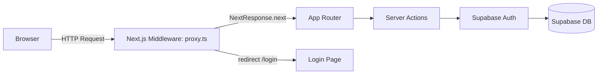

# Next.js + Supabase TODO（認証あり／RLS ON）

# ブランチ
main：本番用（デプロイ用）
dev：開発用（ローカル開発用）
issue#xx：各機能開発用（ブランチを切る）

## 概要
- Next.js v16（Turbopack） App Router + TypeScript + Tailwind
- Supabase（`@supabase/ssr` + `@supabase/supabase-js`）+ RLS（認証必須／ユーザー別アクセス）
- SSR クライアントは `@supabase/ssr`（Dynamic APIs 対応）

## セットアップ
1. リポジトリを取得/作成
2. `.env.local` をプロジェクト直下に作成し、以下を設定
```
NEXT_PUBLIC_SUPABASE_URL=<YOUR_NEXT_PUBLIC_SUPABASE_URL>
NEXT_PUBLIC_SUPABASE_ANON_KEY=<YOUR_NEXT_PUBLIC_SUPABASE_ANON_KEY>
NEXT_USE_PROXY=true   # ミドルウェア(proxy.ts)による未認証リダイレクトを有効化（任意）
```

## Supabase準備
1. Supabaseダッシュボードで新規プロジェクトを作成
2. Project Settings → API から Project URL と anon key を取得
3. Authentication → Email を有効化（必要に応じてConfirm Email設定）
4. SQLエディタで `supabase/schema.sql` を実行
   - `todos` テーブルに `user_id` を追加（`default auth.uid()`）
   - RLSをONにし、`user_id = auth.uid()` のポリシーを `select/insert/update/delete` に適用

## 開発起動
```
npm i
npm run dev
```
- `http://localhost:3000` へアクセス
- 未認証なら `/login` へ自動遷移
- ログイン後、TODOの追加/編集/完了/削除が動作することを確認

## デプロイ（Vercel）
1. Vercel にプロジェクトをインポート
2. `NEXT_PUBLIC_SUPABASE_URL` と `NEXT_PUBLIC_SUPABASE_ANON_KEY` を環境変数として設定
3. デプロイ後に動作確認

## 型生成（任意/推奨）
- Supabase CLI を使用して `database.types.ts` を生成
```
supabase gen types typescript --project-id <プロジェクトref> > database.types.ts
```
- `ref` はダッシュボードURL等から確認可能

## セキュリティ注意
- フロント側では `NEXT_PUBLIC_*` の公開キーのみを使用
- Service Roleキーはサーバー専用で管理し、フロントに置かない
- 機密値は環境変数で管理し、ログに出力しない

## 技術メモ
- 変更系は Server Actions 内で `revalidatePath('/')` を実行
- 一覧は Server Component（SSR）で常に最新を取得
- middlewareでSSRセッション更新と未認証リダイレクトを前段制御

## proxy.ts の役割
- 目的
  - 未認証アクセスを検知し、`/login` へリダイレクト（認証ゲート）
  - Supabase SSR クライアントの Cookie 同期（`setAll/getAll` ブリッジ）
  - プロキシ機能のオン/オフを環境変数で切替（`NEXT_USE_PROXY`）
- 位置付け
  - Next.js Middleware として、ルーティングより前段で全リクエストに適用されます
  - 除外パス（静的・画像等）は `matcher` で制御します
- 処理フロー（簡易図）



- 設定可能なパラメータ

| パラメータ | デフォルト | 説明 |
|---|---|---|
| `NEXT_USE_PROXY` | `.env.local.example` では `true` | ミドルウェアの認証ゲートを有効化。`false` で素通し |
| `NEXT_PUBLIC_SUPABASE_URL` | なし（必須） | Supabase プロジェクト URL |
| `NEXT_PUBLIC_SUPABASE_ANON_KEY` | なし（必須） | Supabase anon key |
| `SUPABASE_SERVICE_ROLE_KEY` | なし | 本アプリでは未使用（サーバー専用用途向け） |

- ミドルウェア適用範囲（`matcher`）

```ts
// proxy.ts の抜粋（適用対象）
export const config = {
  matcher: [
    '/((?!_next/static|_next/image|favicon.ico|.*\.(?:svg|png|jpg|jpeg|gif|webp)$).*)'
  ]
}
```

- セキュリティ
  - Supabase 側は RLS を有効化し、`user_id = auth.uid()` ポリシーでアクセス制御（`supabase/schema.sql`）
  - 環境変数に機密値を置き、ログ出力しない（`NEXT_PUBLIC_*` のみフロントに公開）
  - 本番では HTTPS 経由でのアクセスを前提とし、Cookie の `Secure` 適用を推奨

- パフォーマンス最適化（設計指針）
  - ミドルウェアは軽量化し、除外パスを適切に設定（現状の `matcher` で静的配信は除外）
  - RSC + `Suspense` で初期表示を短縮（本プロジェクトは骨格ローディングあり）
  - CDN（Vercel）配下での配信、画像・静的資産はキャッシュ前提
  - 認証判定はリクエストごとに行うため、未認証ページは必要最低限に留める

参照コード: `proxy.ts:4-36`, `proxy.ts:38-42`

---

## 技術スタック（詳細）
- Next.js `16.0.7`
- React `18.2.0`
- TypeScript `5.6.x`
- Tailwind CSS `3.4.x`
- Supabase SSR `@supabase/ssr` `^0.7.0`
- Supabase JS `@supabase/supabase-js` `^2.45.x`
- Playwright（E2E）

## システムアーキテクチャ図

```mermaid
flowchart TB
  subgraph Client
    UI[UI Components]
  end
  subgraph Next(App Router)
    MW[Middleware proxy.ts]
    RSC[Server Components]
    SA[Server Actions]
    API[/app/api/*/route.ts/]
  end
  subgraph Supabase
    Auth[Auth]
    DB[(Postgres + RLS)]
  end
  UI --> MW --> RSC --> SA --> Auth --> DB
  UI --> API
```

## 環境構築（開発／ステージング／本番）
- 開発
  - `npm i` → `npm run dev`
  - `.env.local` を作成（上記変数を設定）。`NEXT_USE_PROXY=true` で未認証時は `/login` へ誘導
- ステージング／本番（Vercel 例）
  - プロジェクトをインポートし、環境変数 `NEXT_PUBLIC_SUPABASE_URL`, `NEXT_PUBLIC_SUPABASE_ANON_KEY` を設定
  - Supabase 側で Email 認証・RLS を設定し、`schema.sql` を適用
  - デプロイ後、未認証アクセスが `/login` にリダイレクトされることを確認

## 主要API・アクション一覧
- Server Actions
  - `addTodo(formData)` 追加（`app/actions/todos.ts:7-17`）
  - `updateTitle(id, formData)` タイトル更新（`app/actions/todos.ts:19-30`）
  - `toggleCompleted(id, completed)` 完了切替（`app/actions/todos.ts:32-41`）
  - `deleteTodo(id)` 削除（`app/actions/todos.ts:43-49`）
  - `login(prevState, formData)` ログイン（`app/actions/auth.ts:6-18`）
  - `logout()` ログアウト（`app/actions/auth.ts:20-24`、`app/actions/todos.ts:51-55`）
- API Routes（参考）
  - `GET /api/todos` → `{ status: 'ok' }`（`app/api/todos/route.ts:3-5`）

## テスト・品質保証
- E2E（Playwright）
  - 実行: `npm run test:e2e`
  - 変数: `BASE_URL`, `TEST_EMAIL`, `TEST_PASSWORD`
- Lint（ESLint）
  - 実行: `npm run lint`
  - 設定: `eslint.config.mjs` / `.eslintrc.json`
- 型（TypeScript）
  - `tsconfig.json` に準拠

## コントリビューションガイドライン
- Issue → Branch 作成 → PR の流れで作業
- コーディング規約: ESLint/Prettier に準拠、型定義を優先
- 変更前に `npm run lint` を実行して差分をクリーンに
- 機能追加時は README の関連セクションも更新する

## トラブルシューティング
- `Invalid Refresh Token: Refresh Token Not Found`
  - 未ログイン時に `supabase.auth.getUser()` を呼ぶと発生（想定挙動）。`/login` へ遷移で解消
- `Invalid source map ... sourceMapURL could not be parsed`
  - 開発時の依存ライブラリのソースマップ警告。動作へ致命的影響なし
- `permission denied for table todos`
  - RLS ポリシー未設定／不一致。`schema.sql` のポリシー適用を確認
- 未認証でもトップへ到達してしまう
  - `.env.local` の `NEXT_USE_PROXY` を `true` に設定し、`proxy.ts` の `matcher` 対象に含まれているか確認

## 画面/操作
- 上部入力で追加（Server Actions）
- 各行で「保存」ボタンでタイトル更新／完了切替／削除（Server Actions）
- 右上の「ログアウト」ボタンでサインアウト → `/login` へ遷移

## テスト・Lint
- E2Eテスト（Playwright）
  - 実行: `npm run test:e2e`
  - 環境変数: `BASE_URL`, `TEST_EMAIL`, `TEST_PASSWORD`
- Lint（ESLint v9フラットコンフィグ）
  - 実行: `npm run lint`
  - 設定: `eslint.config.mjs`
